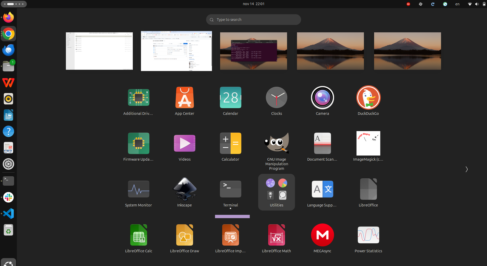
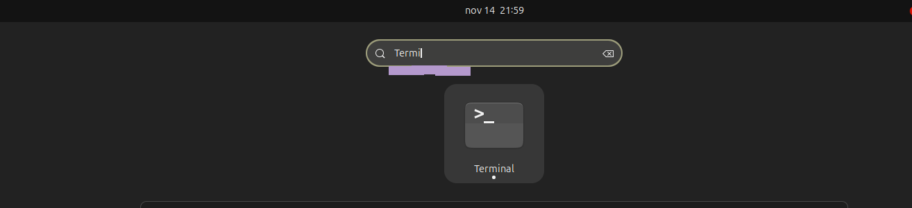
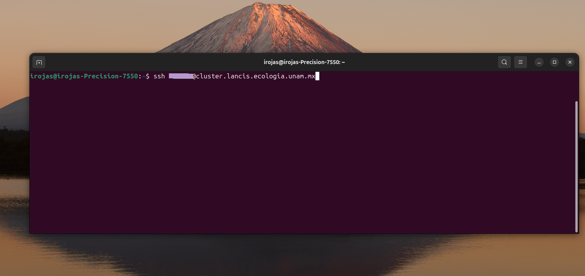
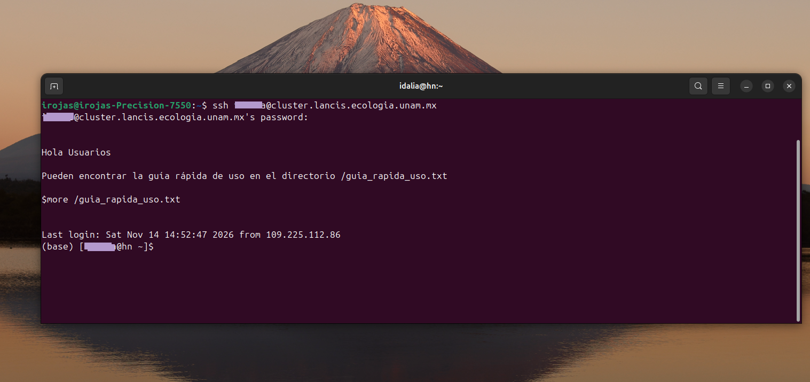

## Usuarios Linux

En Linux (Ubuntu) podemos encontrar la consola en el icono llamado **Terminal**, que ya viene instalada en la computadora. Puedes ubicarla al  hacer click en  el icono **Show Apps**




En el icono de búsqueda introduce el texto **Terminal** y haz click en el icono para desplegarla



### Atajo

También puedes abrir la terminal directamente con el comando **Ctrl + Alt + T**


### Conexion al servidor

Una vez abierta la **Terminal**, deberás conectarte al clúster ingresando tu usuario y contraseña mediante `ssh`:

```
ssh usuario@cluster.lancis.ecologia.unam.mx
```




Ingresa la contraseña asociada a tu usuario. Para ello puedes copiarla  (Ctrl + C) y pegarla (Ctrl + shift + V)

**PRECACIÓN** Si ingresas erróneamente la contrasena tres veces consecutivas, tu usuario sera bloqueado.


Al ingresar al clúster recibirás el mensaje de bienvenida junto con un breve manual que podrás explorar usando el comando `more`. Con esto estarás list@ para trabajar durante el taller:


