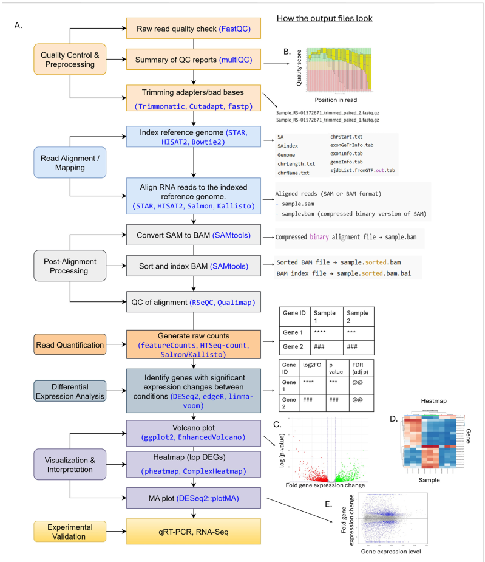
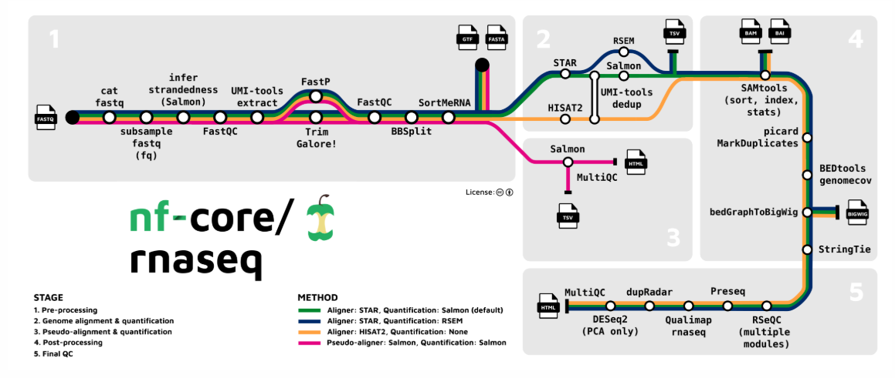

## Sesión 1: Fundamentos, Entorno de Trabajo y Control de Calidad (4 horas)

  **Objetivo**: Establecer las bases conceptuales y técnicas del análisis de RNA-seq, familiarizarse con el entorno HPC/Nextflow y realizar el control de calidad de los datos crudos.

  **Teoría (1.5 horas)**:

## 1. Introducción al análisis de RNA-seq

### 1.1 ¿Qué es RNA-seq y por qué es relevante en Biología Evolutiva?

RNA-seq (RNA sequencing) es una tecnología de secuenciación que permite cuantificar y caracterizar el transcriptoma (el conjunto completo de moléculas de RNA) de una muestra biológica en un momento dado. A diferencia de los microarreglos, RNA-seq no requiere sondas predefinidas, lo que permite descubrir transcritos noveles, isoformas no anotadas y RNAs no codificantes.

En el contexto de la Biología Evolutiva, RNA-seq permite abordar preguntas como:
- ¿Qué genes se expresan diferencialmente entre poblaciones o especies?
- ¿Cómo cambia la expresión génica en respuesta a presiones ambientales?
- ¿Qué isoformas alternativas se expresan en distintos tejidos o estadios de desarrollo?
- ¿Existen genes o transcritos noveles asociados a adaptaciones locales?

**Pregunta**
¿Cuáles son las preguntas clave de tu proyecto de investigación que se pueden abordar mediante el análisis de transcriptomas?

**Concepto clave:** RNA-seq mide  la **abundancia relativa**, no absoluta. Los niveles de RNA mensajeros (mRNA) reflejan el equilibrio entre transcripción y degradación, y se asume que los niveles de proteína están asociados  a los niveles de mRNA. Además, la técnica secuencia **ADN complementario (ADNc)** sintetizado a partir del RNA, no el RNA directamente (con excepciones como la secuenciación directa de RNA de Oxford Nanopore).

### 1.2 Diseño Experimental

El diseño experimental es el paso más crítico para garantizar la validez y reproducibilidad de un estudio de RNA-seq. **Un mal diseño no puede corregirse en el análisis.**

#### 1.2.1 Réplicas biológicas y técnicas

- **Réplicas biológicas:** Son **esenciales** para cualquier análisis inferencial. Permiten estimar la variabilidad biológica y distinguirla del ruido técnico. Sin réplicas biológicas, **cualquier cálculo de valor p es inválido** y no se puede hacer inferencia poblacional.

- **Mínimo recomendado:** 3 réplicas biológicas por condición es el estándar mínimo. Sin embargo, estudios de potencia estadística sugieren que 3 réplicas detectan solo ~20–40% de los genes verdaderamente diferenciales; se requieren 6 o más para una detección robusta.

- **Réplicas técnicas:** Generalmente **no son necesarias** debido a la baja variación técnica de RNA-seq. La reproducibilidad técnica es alta y está bien controlada por el protocolo.


Fig.1.  Diseño Experimental (Antoszewski K et al. 2026)


**Consideraciones específicas para Biología Evolutiva:**

- En especies no modelo o muestras de campo, la variabilidad biológica puede ser alta. Se recomienda aumentar el número de réplicas si es posible.
- Si se comparan poblaciones o especies, **idelamente  las réplicas deben representar la diversidad genética de cada grupo.**

#### 1.2.2 Contraste y factores experimentales

El diseño debe definir claramente:
- **Factor principal:** La variable biológica de interés (ej. especie, población, tratamiento, tejido).
- **Covariables:** Factores que pueden confundir el análisis (ej. sexo, edad, lote de secuenciación).
- **Contrastes:** Las comparaciones específicas que se realizarán (ej. Especie A vs. Especie B, Tratamiento vs. Control).

#### 1.2.3 Efecto del lote (Batch effect)

Los **efectos de lote (batch effect)** son variaciones en las muestras que **no se deben a efectos biológicos**, sino a diferencias técnicas: procesamiento en días distintos, por personas distintas, con kits de extracción diferentes, o secuenciación en carriles/máquinas diferentes.

**Regla de oro:** Si no se pueden procesar todas las muestras juntas, **nunca** procesar todas las muestras de un grupo (ej. "tratamiento") en un lote y todas las del otro grupo (ej. "control") en otro lote. Los efectos de lote se confundirían con el efecto biológico y serían incorregibles.

**Estrategia:** Aleatorizar las muestras a través de los lotes, asegurando que cada lote contenga réplicas de todos los grupos experimentales. Si el efecto de lote es inevitable, puede corregirse bioinformáticamente (ej. ComBat-seq, RUVSeq) solo si está balanceado.

#### 1.2.4 Secuenciación Single-end vs. Paired-end

| Característica             | Single-end (SE)                                              | Paired-end (PE)                                              |
| :------------------------- | :----------------------------------------------------------- | :----------------------------------------------------------- |
| **Definición**             | Secuencia solo un extremo del fragmento de ADNc              | Secuencia ambos extremos del fragmento                       |
| **Mapeo**                  | Menos preciso en regiones repetitivas                        | Mayor precisión; el tamaño del inserto ayuda al mapeo        |
| **Detección de isoformas** | Limitada                                                     | Superior; facilita la identificación de uniones exón-exón    |
| **Costo**                  | Menor                                                        | Mayor (aproximadamente el doble de lecturas)                 |
| **Recomendación**          | Suficiente para cuantificación génica en genomas bien anotados | **Preferido** para descubrimiento de transcritos, isoformas y genomas pobremente anotados |

**Para Biología Evolutiva:** Dado que la mayoría de los  organismos no modelo tienen anotaciones incompletas o no están anotados, **se recomienda paired-end** para maximizar la información obtenida.

#### 1.2.5 Direccionalidad (Strandedness)

Los protocolos **strand-specific** (direccionales) preservan información sobre qué hebra del DNA  fue transcrita. Esto es crucial cuando:
- Existen genes superpuestos en hebras opuestas.
- Se analizan transcritos antisentido.
- Se estudia splicing alternativo.

Los protocolos no direccionales pierden esta información, complicando la cuantificación en regiones genómicas complejas. 

Hay kits comerciales que garantizan la direccionalidad y  permiten conervar esta información, por ejemplo: Illumina Stranded mRNA Prep, Ligation, llumina Stranded Total RNA Prep, Ligation with Ribo-Zero Plus (para RNA total / RNA largos no codificantes), NEBNext Ultra II Directional RNA Library Prep Kit, etc. 

Detección de strandedness con Salmon (parámetro --libType A)
El parámetro ``` -l A ``` permite que Salmon detecte automáticamente el tipo de biblioteca (library type). 


### 1.3 Formatos de Archivo

#### FASTQ (datos crudos)
Formato de texto que contiene las secuencias de lecturas y sus puntuaciones de calidad (Phred). Cada lectura ocupa 4 líneas:
1. `@` + identificador
2. Secuencia de nucleótidos
3. `+`
4. Puntuaciones de calidad codificadas en ASCII

La calidad Phred (Q) se relaciona con la probabilidad de error: Q30 = 99.9% de precisión (1 error en 1000 bases). **Q30 es el umbral estándar** para considerar una base de alta calidad.

#### FASTA (secuencias de referencia)
Contiene secuencias de nucleótidos o aminoácidos. La primera línea comienza con `>` seguido del identificador. Se usa para el genoma de referencia o el transcriptoma.

#### GTF/GFF (anotación genómica)
Archivos tabulados que describen las características del genoma (genes, transcritos, exones, CDS) con sus coordenadas. **GTF** (Gene Transfer Format) es el estándar para análisis de expresión; **GFF** (General Feature Format) es más general. Ambos pueden convertirse entre sí. La anotación es esencial para asignar lecturas mapeadas a genes o transcritos y generar la matriz de conteos.

**Nota:** La versión del genoma y la fuente de anotación (Ensembl, RefSeq, GENCODE) deben documentarse y mantenerse consistentes a lo largo del análisis y para comparaciones con estudios previos.


## 2. Estrategias de Análisis Comparadas

### 2.1 Cuantificación por referencia (Reference-based)

Las lecturas se mapean contra un genoma o transcriptoma de referencia conocido. Requiere:
- Genoma de referencia (FASTA)
- Anotación (GTF/GFF)
- Alineador splice-aware (considera la presencia de  intrones): **STAR**, **HISAT2**, **TopHat2**

**Ventajas:** Permite identificar genes y transcritos conocidos, y también descubrir nuevos transcritos si se permite el mapeo sin anotación previa.  
**Limitación:** Depende de la calidad y completitud del genoma de referencia.

**Pseudoalineadores:** **Salmon** y **Kallisto** cuantifican la abundancia de transcritos sin realizar un alineamiento base por base. Son mucho más rápidos y usan menos memoria, tienen precisión comparable para cuantificación, pero **no permiten descubrir transcritos noveles** ni inspeccionar alineamientos visualmente.

### 2.2 Cuantificación sin referencia (*De novo*)

Para organismos sin genoma de referencia o con genomas incompletos. Las lecturas se ensamblan en transcritos (contigs) usando herramientas como **Trinity**, **SOAPdenovo-Trans**, **Oases** o **Trans-ABySS**. Luego, las lecturas se mapean de vuelta al transcriptoma ensamblado para cuantificación.

**Ventajas:** Permite estudiar organismos no modelo.  
**Limitaciones:** El ensamblaje de lecturas cortas es computacionalmente intensivo y propenso a errores; las isoformas de baja expresión pueden no ensamblarse. Se prefieren lecturas paired-end y largas. Los transcritos ensamblados requieren anotación funcional posterior (ej. BLAST, Blast2GO).

**Consideración para Biología Evolutiva:** El ensamblaje *de novo* es frecuente en estudios de organismos no modelo. La calidad del ensamblaje afecta directamente la cuantificación y la interpretación biológica. Se recomienda combinar estrategias *de novo* y guiadas por refrencua cuando se dispone de un genoma parcial o pobremente anotado, o emplear como referencia una especie cercana.

### 2.3 Presentación de los conjuntos de datos del curso

- ***Abies religiosa*** (Oyameles): especie de conífera de importancia ecológica en México; el set de datos fue  generado para la publicación: [Histologic, metabolomic, and transcriptomic differences in fir trees from a peri-urban forest under chronic ozone exposure](https://onlinelibrary.wiley.com/doi/10.1002/ece3.11343)
.
- ***Genypterus maculatus*** (Pex pistola): pez marino de interés comercial, el set de datos fue generado para la publicacion: [Fuente]().

**Nota:** Cuando se requiere un  ensamblaje *de novo* es aún más crítico el control de calidad y el diseño experimental riguroso.

## 3. Flujo de Trabajo General de un Pipeline de RNA-seq

El análisis de RNA-seq se divide en dos grandes etapas:

1. **Análisis primario o preprocesaminto:** FASTQ → Matriz de conteos (QC, limpieza, alineamiento/mapeo, cuantificación).
2. **Análisis secundario y terciario:** Matriz de conteos → Expresión diferencial → Interpretación biológica (análisis de enriquecimiento, vías, etc.).




Fig 2. RNAseq pipeline (Dawadi et al. 2025)

### 3.1 Introducción a Conda, Nextflow y HPC

#### 3.1.1 ¿Qué es Conda?
Conda es un **gestor de paquetes y de entornos (package and environment manager)** de código abierto. Se usa principalmente en bioinformática, ciencia de datos y computación científica para instalar software y sus dependencias de forma aislada y reproducible [source](https://www.anaconda.com/about-us#).

**Gestor de paquetes**
Instala software ya compilado ("binarios") desde repositorios como **Anaconda**, **conda-forge** o **bioconda**, resolviendo automáticamente las dependencias (bibliotecas, versiones compatibles, etc.). Ejemplo

bash

```
conda install -c bioconda fastqc multiqc
```

**Gestor de entornos**
Crea espacios aislados donde cada proyecto tiene sus propias versiones de software, sin interferir entre sí ni con el sistema.

bash
```
conda create -n rembe_qc -c bioconda -c conda-forge fastqc multiqc
conda activate rembe_qc    # entras al entorno
conda deactivate           # sales del entorno
```

#### 3.1.2 ¿Qué es Nextflow?
Nextflow es un motor de orquestación de flujos de trabajo y un lenguaje específico de dominio (DSL: Domain Specific Languge) de código abierto, diseñado principalmente para facilitar la escritura y ejecución de flujos de trabajo computacionales intensivos en datos . En  bioinformática, ** usualmente se utiliza  para conectar diversas herramientas de análisis (como FastQC, MultiQC, alineadores, etc.) ** y construir procesos de análisis reproducibles, portables y escalables


**nf-core/rnaseq** es un pipeline bioinformático que se puede utilizar para analizar datos de secuenciación de RNA obtenidos de organismos que cuentan con un **genoma de referencia y anotación**. Toma como entrada una hoja de muestras (*samplesheet*) y archivos FASTQ, realiza control de calidad (QC), recorte (*trimming*) y (pseudo)alineamiento, y produce una matriz de expresión génica y un informe extensivo de control de calidad.




**Tip:**Nextflow cuenta con docenas de pipelines preconatruidos que estan disponibles en su sitio web: https://nf-co.re/pipelines/


**1. Si quisieras hornear un pastel, ¿qué tareas ejecutaría Conda y cuáles corresponderían a Nextflow?**

<!--
Lista de ingredientes exactos → environment.yml  (parte de Conda)
Almacén que provee los ingredientes       → 		Conda
Receta (pasos y orden) + chef       → 			Nextflow
-->

#### 3.1.3 Conda vs Nextflow

- **Conda** → gestiona **software** (qué programas y qué versiones hay instalados).
- **Nextflow** → gestiona **ejecución** (en qué orden se ejecutan los programas y en qué máquina).


| Aspecto                 | **Conda**                                                    | **Nextflow**                                                 |
| :---------------------- | :----------------------------------------------------------- | :----------------------------------------------------------- |
| **Qué es**              | Gestor de paquetes y entornos                                | Motor de orquestación de flujos de trabajo                   |
| **Qué gestiona**        | **Software**: instala/aisla versiones de programas (FastQC, Python, Java…) | **Ejecución**: orden, paralelismo, dependencias entre pasos, reintentos |
| **Unidad de trabajo**   | Un **paquete** (p. ej. `fastqc=0.12.1`)                      | Un **proceso** (p. ej. ejecutar FastQC sobre una muestra)    |
| **Aísla**               | Entornos de software (`rembe_qc`, `rembe_align`…)            | Pasos del pipeline y su ejecución (local, SLURM, nube)       |
| **Lenguaje**            | Comandos de shell (`conda install/create/activate`)          | DSL propio (`main.nf`: `process`, `workflow`, `channel`)     |
| **Escala**              | Un entorno por proyecto/máquina                              | Miles de tareas en paralelo en un clúster o nube             |
| **Reproducibilidad**    | Fija **versiones de software** (`environment.yml`)           | Fija **el flujo completo** + puede fijar software vía contenedores/Conda |
| **Reanudar tras fallo** | ❌ No aplica                                                  | ✅ `-resume` (omite pasos ya hechos)                          |
| **Se ejecuta en**       | Tu shell / nodo                                              | Local, SLURM, SGE, Kubernetes, AWS…                          |


####  3.1.4 ¿Qué es la computación de alto rendimiento (HPC)?

La HPC es una tecnología que utiliza clústeres de potentes procesadores que trabajan en paralelo para procesar conjuntos de datos masivos y multidimensionales y resolver problemas complejos a velocidades extremadamente altas.

La HPC resuelve en tiempo real algunos de los problemas informáticos más complejos de la actualidad. Los sistemas HPC suelen funcionar a velocidades más de un millón de veces superiores a las de los sistemas básicos más rápidos de ordenadores de sobremesa, portátiles o servidores [fuente](https://www.ibm.com/es-es/think/topics/hpc).

La computación de alto rendimiento utiliza clústeres de procesadores potentes que trabajan en paralelo para procesar grandes volúmenes de datos. Los sistemas HPC son esenciales para RNA-seq porque:

- El alineamiento (especialmente con STAR) requiere **mucha memoria RAM**. 
- El procesamiento de múltiples muestras se beneficia de la **paralelización**.
- El almacenamiento de archivos BAM/FASTQ puede ser de cientos de GB.

**1. Pregunta.  Cual es la ventaja de usar  conda y/o nextflow en un entono  como los HPC?**

<!--
Conda: Resuelve el problema de las dependencias de software

La ventaja de Conda en HPC es que **proporciona entornos de software aislados y reproducibles**, permitiéndote evitar el sistema de "módulos" (modules) del clúster, que es lento y a veces restrictivo.

Nextflow: Resuelve el problema de la orquestación de flujos de trabajo

La ventaja de Nextflow en HPC es que **abstrae la complejidad de la programación de trabajos**, permitiéndote gestionar la paralización, el manejo de errores y la migración entre plataformas con código simple.
--> 

### 3.2. Conceptos de Paralelización, Reproducibilidad y Estructura de un Pipeline

#### 3.2.1 Paralelización

Nextflow y SLURM permiten ejecutar procesos en paralelo de forma automática. Por ejemplo, si se tienen 12 muestras, FastQC puede ejecutarse simultáneamente para todas ellas (si los recursos del clúster lo permiten), reduciendo drásticamente el tiempo total. El `nextflow.config` define los recursos (CPUs, memoria, tiempo) para cada proceso y el ejecutor (local, SLURM, etc.).

#### 3.2.2 Reproducibilidad

Un pipeline reproducible debe:

- Fijar versiones de software (Conda `environment.yml` o contenedores).
- Documentar parámetros y versiones de referencia.
- Usar control de versiones (Git) para los scripts.
- Permitir la re-ejecución con `-resume`.

#### 3.2.3 Estructura básica de un pipeline Nextflow

- **`main.nf`:** Define los procesos (`process`) y el flujo de trabajo (`workflow`). Los canales (`Channel`) conectan las salidas de un proceso con las entradas del siguiente.
- **`nextflow.config`:** Configura el ejecutor, los recursos, los parámetros del pipeline y los perfiles (ej. `slurm`, `local`).


## Pausa (20 min)


## 4. Práctica en HPC con Nextflow (2.5 horas)

### 4.1 Configuración del entorno

1. Acceso al clúster HPC.
2. Carga de módulos: Nextflow y Java (Nextflow requiere Java 11+).
3. Verificación de la instalación: `nextflow run hello`.
4. Examinación del conjunto de datos: archivos FASTQ, genoma de referencia (FASTA) y anotación (GTF).

### 4.2 Control de Calidad Inicial con FastQC

**FastQC** evalúa la calidad de las lecturas crudas. Métricas clave:

- **Calidad por base:** Debe mantenerse alta (>Q30) a lo largo de la lectura; caídas al final son comunes pero no deseables.
- **Contenido de GC:** Debe seguir una distribución aproximadamente normal. Desviaciones pueden indicar contaminación o sesgo.
- **Secuencias adaptadoras:** Su presencia indica que la limpieza es necesaria.
- **Secuencias sobrerrepresentadas:** Pueden ser biológicas (ej. rRNA) o contaminantes.
- **Niveles de duplicación:** En RNA-seq, duplicados de transcritos altamente expresados son esperados, pero duplicados excesivos pueden indicar artefactos de PCR.

**Herramienta:** `fastqc muestra_R1.fastq.gz muestra_R2.fastq.gz`

### 4.3 Limpieza y Poda de Lecturas con Trimmomatic

**Objetivos:**

- Eliminar adaptadores.
- Recortar bases de baja calidad (umbral Q<30).
- Filtrar lecturas demasiado cortas (ej. <20–30 nt).
- Manejo correcto de datos paired-end (ambas lecturas deben procesarse simultáneamente; si una se descarta, la otra queda huérfana).

**Opciones típicas de Trimmomatic para PE:**

```bash
trimmomatic PE -phred33 \
  muestra_R1.fastq.gz muestra_R2.fastq.gz \
  muestra_R1_paired.fq.gz muestra_R1_unpaired.fq.gz \
  muestra_R2_paired.fq.gz muestra_R2_unpaired.fq.gz \
  ILLUMINACLIP:adapters.fa:2:30:10 \
  LEADING:3 TRAILING:3 SLIDINGWINDOW:4:15 MINLEN:36
```

### 4.4 Control de Calidad Post-Limpieza

Re-ejecutar FastQC sobre los archivos filtrados para verificar:

- Mejora en las puntuaciones de calidad.
- Eliminación de adaptadores.
- Distribución de longitudes de lectura.

### 4.5 Reporte Agregado con MultiQC

**MultiQC** agrega los reportes de FastQC (y otras herramientas) de todas las muestras en un único informe HTML interactivo. Esto facilita:

- Detección de muestras problemáticas (outliers).
- Comparación visual entre muestras.
- Documentación de la calidad del experimento.

**Comando:** `multiqc .` (ejecutado en el directorio que contiene los reportes de FastQC). 

---

## Referencias

- Conesa, A. et al. (2016). A survey of best practices for RNA-seq data analysis. *Genome Biology*, 17:13.
- Antoszewski, K. et al. (2026). Designing RNA sequencing experiments: A practical guide to reproducible gene expression analysis. *Computational and Structural Biotechnology Journal*.
- Dawadi, P. et al. (2025). From bench to bytes: a practical guide to RNA sequencing data analysis. *Frontiers in Genetics*, 16:1697922.
- Lee, G.-Y. et al. (2024). Brief guide to RNA sequencing analysis for nonexperts in bioinformatics. *Molecules and Cells*, 47(5):100060.
- Pasmanik-Chor, M. (2021). Biological Perspectives of RNA-Sequencing Experimental Design. *Methods in Molecular Biology*.
- Zhao, S. et al. (2018). Evaluation of two main RNA-seq approaches for gene quantification in clinical RNA sequencing: PolyA+ selection versus rRNA depletion. *Scientific Reports*, 8:4781.
- NCI BTEP. Introduction to RNA-Seq Data Analysis [Peter FitzGerald](https://bioinformatics.ccr.cancer.gov/docs/bioinformatics-for-beginners-2025/RNASeq_2024.pdf)
- Bioconda documentation: https://bioconda.github.io/
- Nextflow documentation: https://nextflow.io/