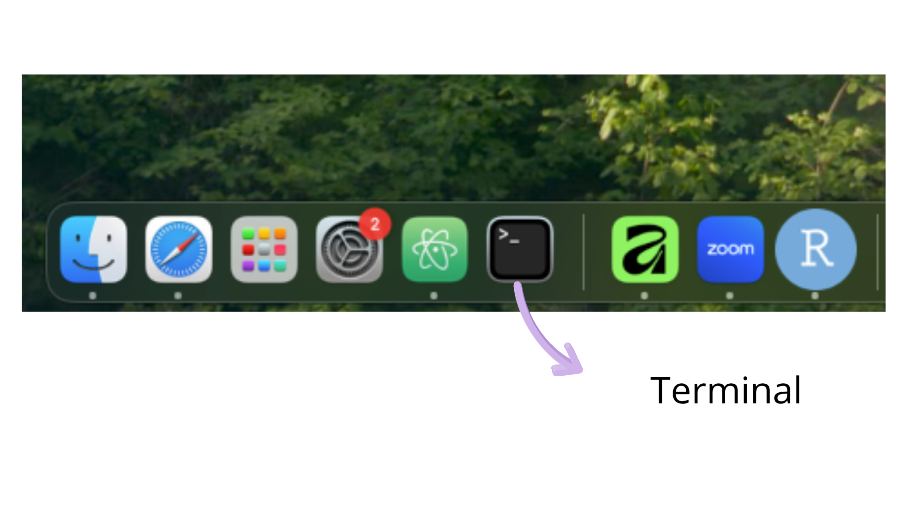
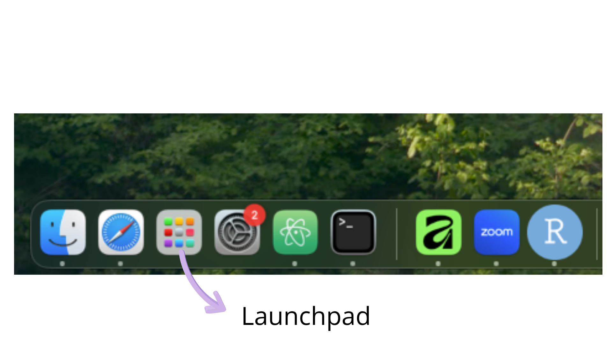
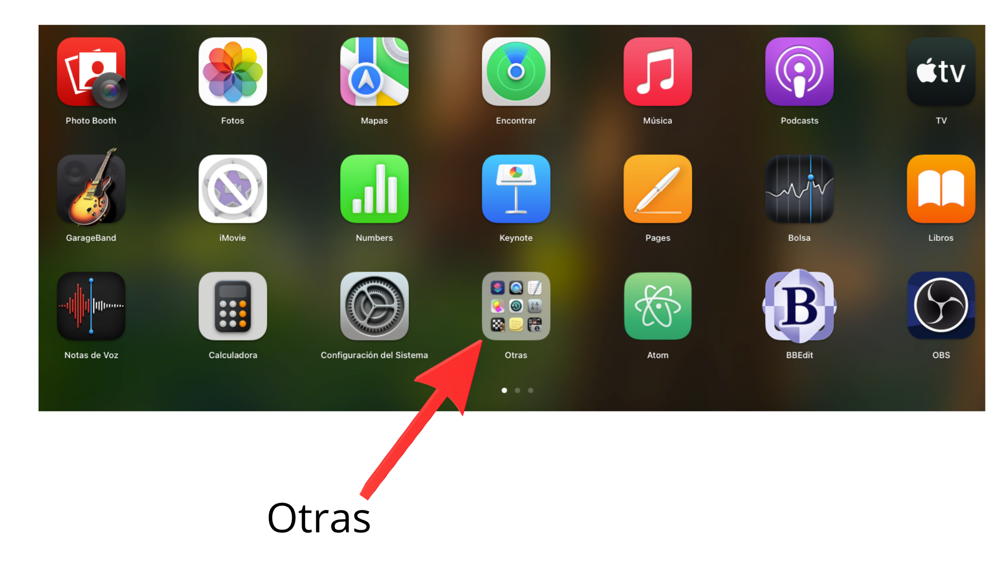
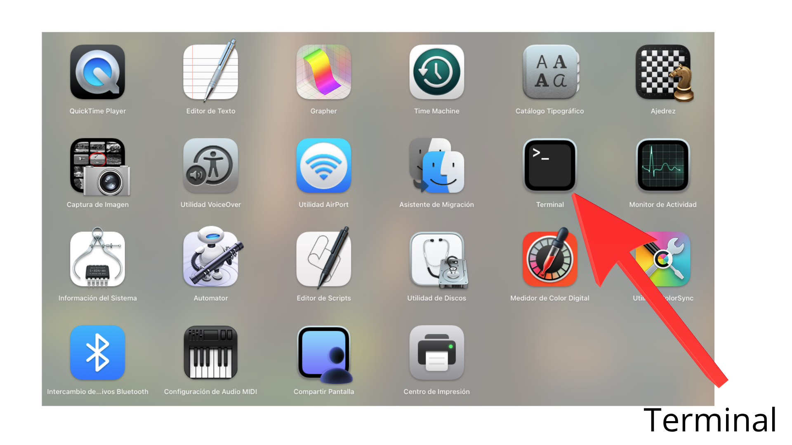
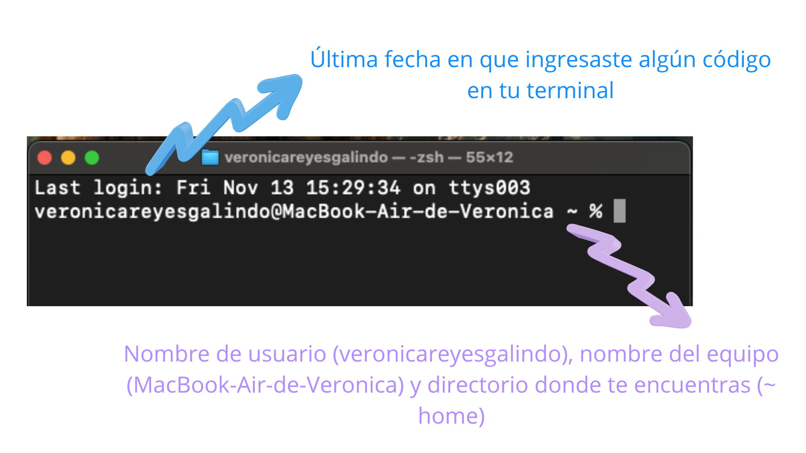
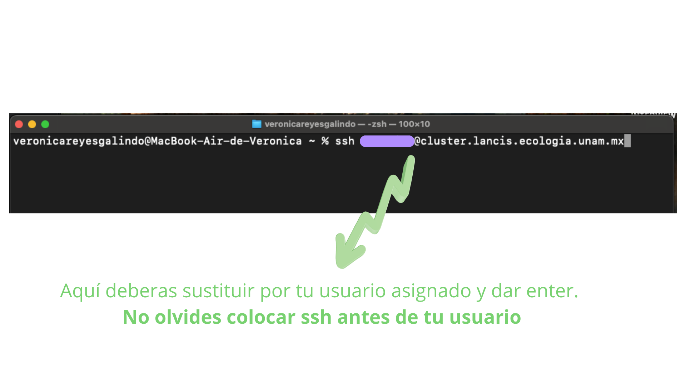
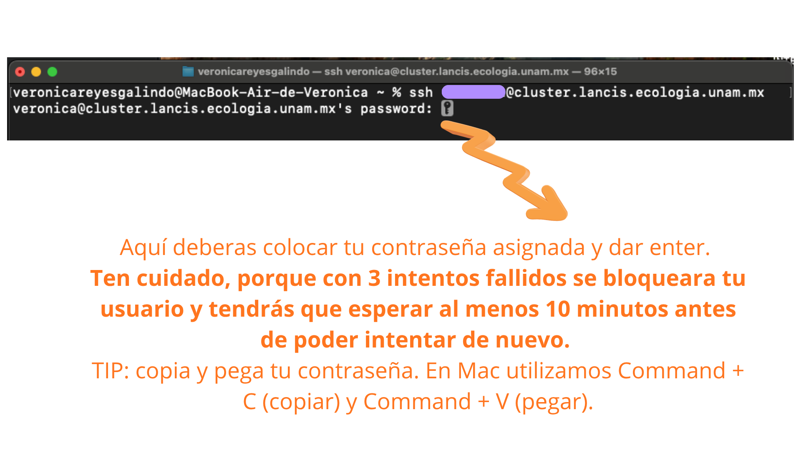
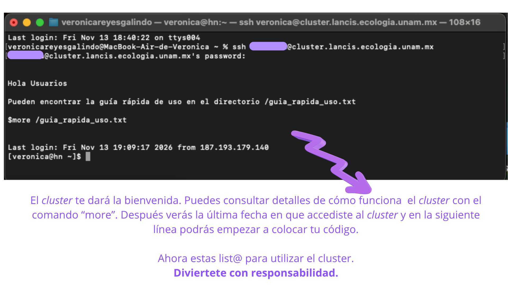

## Usuarios Mac

En Mac podemos encontrar la consola en el icono llamado **Terminal**, que ya viene instalado en la computadora. Puedes ubicarla directamente en tu **Dock** (la barra de herramientas que aparece en el borde inferior o lateral de tu pantalla):

También puedes abrirla siguiendo esta ruta: **Launchpad** -> **Otras** -> **Terminal**.

Para iniciar la consola, haz doble clic sobre el icono **Terminal** y se abrirá una ventana similar a la siguiente:

Una vez abierta la **Terminal**, deberás conectarte al clúster ingresando tu usuario y contraseña mediante `ssh`:

Al ingresar al clúster recibirás el mensaje de bienvenida junto con un breve manual que podrás explorar usando el comando `more` seguido del nombre del archivo guia_rapida_uso.txt (`more /guia_rapida_uso.txt`). Con esto estarás list@ para trabajar durante el taller:

